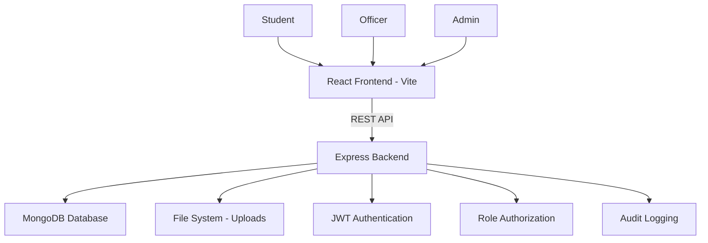

# ScholarFlow — Digital Scholarship Application and Management System

> A complete, production-style MERN stack web application for managing the full scholarship lifecycle from application to disbursement.

---

## 🎯 Problem Statement

Educational institutions still process scholarship applications manually, resulting in lengthy approval cycles, excessive paperwork, lost documents, poor tracking, and limited transparency. ScholarFlow digitizes the complete scholarship lifecycle.

---

## ✨ Features

### Student
- Register & complete profile
- Browse and search scholarships
- Check eligibility (CGPA, income, course, category)
- Create applications and save as draft
- Upload required documents
- Submit applications
- Track application status with timeline
- Receive in-app notifications
- View approval/rejection details

### Officer
- View all submitted applications
- Review student information and documents
- Verify/reject documents
- Request corrections from students
- Verify and approve/reject applications
- Add remarks

### Admin
- Manage students and officers
- Create, edit, activate/deactivate scholarships
- Configure eligibility criteria
- Monitor all applications
- View analytics and charts
- View complete audit logs
- Process scholarship disbursements

---

## 🛠️ Technology Stack

| Layer | Technology |
|---|---|
| Frontend | React.js (Vite), Tailwind CSS, React Router, Recharts |
| Backend | Node.js, Express.js |
| Database | MongoDB, Mongoose |
| Auth | JWT, bcryptjs |
| File Upload | Multer |
| State | React Context API |
| HTTP Client | Axios |

---

## 🏗️ Architecture



### Backend Architecture
```
Routes → Controllers → Services → Models → MongoDB
```

---

## 📁 Project Structure

```
ScholarFlow/
├── client/                     # React Frontend (Vite)
│   └── src/
│       ├── components/         # Reusable UI components
│       │   ├── ui/             # Generic UI (Badge, Modal, Pagination)
│       │   └── shared/         # Route guards
│       ├── context/            # AuthContext
│       ├── hooks/              # Custom hooks
│       ├── layouts/            # DashboardLayout
│       ├── pages/              # Page components
│       │   ├── student/        # Student pages
│       │   ├── officer/        # Officer pages
│       │   └── admin/          # Admin pages
│       ├── services/           # API service modules
│       └── utils/              # Helper utilities
└── server/                     # Express Backend
    ├── config/                 # DB connection
    ├── controllers/            # Request handlers
    ├── middleware/             # Auth, error, upload
    ├── models/                 # Mongoose schemas
    ├── routes/                 # Route definitions
    ├── services/               # Business logic
    └── utils/                  # Helpers, seed
```

---

## 🗄️ Database Models

| Model | Purpose |
|---|---|
| User | Authentication and roles |
| Student | Academic and personal profile |
| Scholarship | Scholarship program details |
| Application | Application lifecycle |
| Document | Uploaded file metadata |
| Notification | In-app notifications |
| AuditLog | Complete system audit trail |
| Disbursement | Payment tracking |

---

## 🔄 Application Workflow

```
Student Registers → Completes Profile → Browses Scholarships →
Checks Eligibility → Creates Application → Uploads Documents →
Submits → SUBMITTED → Officer Reviews → 
  └─ CORRECTION_REQUIRED → Student corrects → RESUBMITTED
  └─ VERIFIED → UNDER_EVALUATION → APPROVED → DISBURSED
                                 └─ REJECTED
```

---

## 🚀 Installation & Setup

### Prerequisites
- Node.js v18+
- MongoDB (local or Atlas)
- npm v9+

### 1. Clone the Repository
```bash
git clone <repository-url>
cd ScholarFlow
```

### 2. Backend Setup
```bash
cd server
npm install
```

Create `.env` file:
```env
NODE_ENV=development
PORT=5000
MONGODB_URI=mongodb://localhost:27017/scholarflow
JWT_SECRET=your_super_secret_jwt_key_here
JWT_EXPIRE=7d
CLIENT_URL=http://localhost:5173
MAX_FILE_UPLOAD=10485760
```

### 3. Frontend Setup
```bash
cd ../client
npm install
```

### 4. Seed Development Data
```bash
cd server
npm run seed
```

---

## 🏃 Running the Application

### Backend
```bash
cd server
npm run dev    # Development (nodemon)
npm start      # Production
```

### Frontend
```bash
cd client
npm run dev    # Development server (Vite)
npm run build  # Production build
```

The app will be available at:
- Frontend: http://localhost:5173
- Backend API: http://localhost:5000/api
- Health Check: http://localhost:5000/api/health

---

## 🔐 Development Credentials

> ⚠️ **Development Only** — Do NOT use in production

| Role | Email | Password |
|---|---|---|
| Admin | admin@scholarflow.dev | Admin@1234 |
| Officer | officer@scholarflow.dev | Officer@1234 |
| Student | student@scholarflow.dev | Student@1234 |

---

## 📡 API Documentation

### Authentication
```
POST   /api/auth/register     Register new student
POST   /api/auth/login        Login
GET    /api/auth/me           Get current user
POST   /api/auth/logout       Logout
```

### Students
```
GET    /api/students/profile      Get profile
PUT    /api/students/profile      Update profile
GET    /api/students/applications Get student applications
```

### Scholarships
```
GET    /api/scholarships                  List scholarships
GET    /api/scholarships/:id              Get scholarship
GET    /api/scholarships/:id/eligibility  Check eligibility
POST   /api/scholarships                  Create (Admin)
PUT    /api/scholarships/:id              Update (Admin)
PATCH  /api/scholarships/:id/status       Update status (Admin)
DELETE /api/scholarships/:id              Delete (Admin)
```

### Applications
```
POST   /api/applications                    Create application
GET    /api/applications                    List applications
GET    /api/applications/:id                Get application
PUT    /api/applications/:id                Update draft
POST   /api/applications/:id/submit         Submit
PATCH  /api/applications/:id/request-correction  Request correction
PATCH  /api/applications/:id/verify         Verify
PATCH  /api/applications/:id/approve        Approve
PATCH  /api/applications/:id/reject         Reject
```

### Documents
```
POST   /api/documents/upload            Upload document
GET    /api/documents/:applicationId    Get documents
PATCH  /api/documents/:id/verify        Verify document
PATCH  /api/documents/:id/reject        Reject document
```

### Notifications
```
GET    /api/notifications               Get notifications
PATCH  /api/notifications/read-all      Mark all read
PATCH  /api/notifications/:id/read     Mark as read
```

### Admin
```
GET    /api/admin/dashboard             Dashboard stats
GET    /api/admin/users                 List users
POST   /api/admin/users/officer         Create officer
PATCH  /api/admin/users/:id/toggle-status  Toggle status
GET    /api/admin/audit-logs            Audit logs
GET    /api/admin/statistics            Statistics
```

### Disbursements
```
POST   /api/disbursements       Initiate disbursement
GET    /api/disbursements       List disbursements
PATCH  /api/disbursements/:id   Update disbursement
```

---

## 🌱 Environment Variables

| Variable | Description | Default |
|---|---|---|
| `NODE_ENV` | Environment mode | development |
| `PORT` | Server port | 5000 |
| `MONGODB_URI` | MongoDB connection string | — |
| `JWT_SECRET` | JWT signing secret | — |
| `JWT_EXPIRE` | JWT expiry duration | 7d |
| `CLIENT_URL` | Frontend origin for CORS | http://localhost:5173 |
| `MAX_FILE_UPLOAD` | Max upload size in bytes | 10485760 (10MB) |

---

## 🔒 Security Features

- bcrypt password hashing (salt rounds: 12)
- JWT authentication with expiry
- Role-based access control (RBAC)
- Protected routes on both frontend and backend
- File type and size validation
- CORS configuration
- Rate limiting (200 req/15min, 20 auth req/15min)
- Environment variables for secrets
- Input validation
- Secure error handling

---

## 📊 Application Number Format

```
SCH-YYYY-XXXXXX
Example: SCH-2026-000124
```

---

## 🧪 Testing

### Basic API Tests (with Postman/curl)

1. **Health Check**: `GET http://localhost:5000/api/health`
2. **Register**: `POST /api/auth/register`
3. **Login**: `POST /api/auth/login`
4. **Check auth**: `GET /api/auth/me` (with Bearer token)
5. **Unauthorized**: Access student endpoint as officer → expect 403

---

## 🔮 Future Enhancements

- Email/SMS notifications
- Advanced document OCR verification
- AI-assisted scholarship recommendation
- Payment gateway integration
- Multi-institution support
- Multilingual support (i18n)
- Government API integration
- Advanced fraud detection
- Mobile application
- Advanced analytics and reporting

---

## 👥 User Roles Summary

| Feature | Student | Officer | Admin |
|---|---|---|---|
| Register | ✅ | — | — |
| Browse Scholarships | ✅ | — | ✅ |
| Apply | ✅ | — | — |
| Upload Documents | ✅ | — | — |
| Track Applications | ✅ Own only | ✅ All | ✅ All |
| Verify Documents | — | ✅ | ✅ |
| Approve/Reject | — | ✅ | ✅ |
| Create Scholarships | — | — | ✅ |
| Manage Users | — | — | ✅ |
| View Analytics | — | — | ✅ |
| Process Disbursements | — | — | ✅ |
| View Audit Logs | — | — | ✅ |

---

*ScholarFlow — Built as a Final Year Project demonstrating production-grade MERN stack development.*
